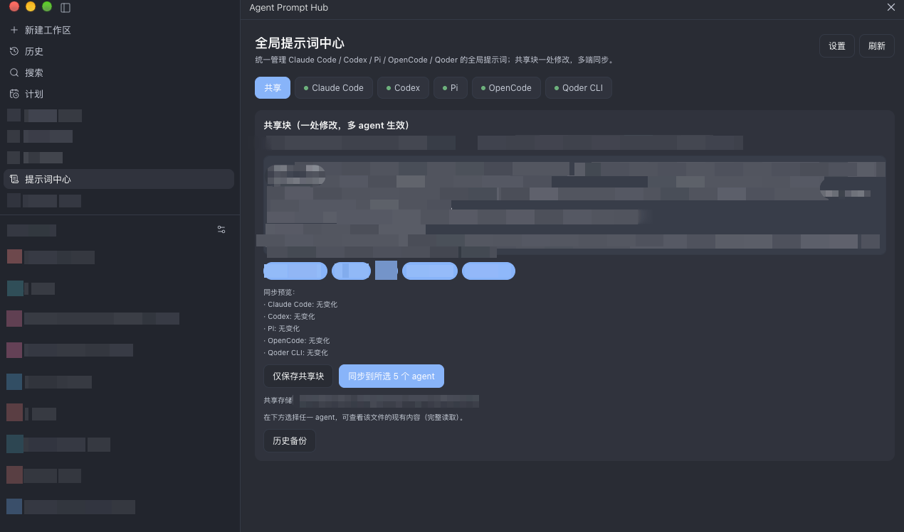

# Agent Prompt Hub

Paseo 插件：在一个界面里聚合管理 Claude Code / Codex / Pi / OpenCode / Qoder 的**全局提示词文件**，并支持"共享块一处修改、多端同步"。



## 功能

- **侧边栏顶部入口**（Prompt Hub，左上角），也可以通过 ⌘K 搜 "Open Agent Prompt Hub" 打开
- **统一管理**：五个 agent 的全局提示词统一查看与编辑；打开即**完整读取现有文件内容**，保存以它为基线，不会静默覆盖
- **共享块 + 同步预览**：写一段内容，一键同步到任意多个 agent；同步前预览每个文件将执行的操作（创建 / 追加 / 更新 / 移除 / 无变化），追加与更新都明确标注"原有内容保留"；清空内容后同步 = 从所有文件移除共享块
- **安全写入**：写前自动备份（保留份数可配置）、mtime + sha256 冲突检测（外部修改时拒绝覆盖）、原子写入、保留权限位与换行风格
- **历史备份**：查看并一键恢复任意历史版本（恢复前会先备份当前版本）
- **更新提示**：主界面顶部检查 registry 上的新版本；有新版本时显示横幅与更新命令（仅读取公开的 registry 记录与对应提交的 package.json，不上传任何数据）
- **国际化**：默认英文，可在设置中切换中文
- **设置**：自定义每个 agent 的文件路径、备份保留数量、只读模式、默认同步目标、语言

## 目标文件

| Agent | 全局提示词文件 | 环境变量覆盖 |
| --- | --- | --- |
| Claude Code | `~/.claude/CLAUDE.md` | `CLAUDE_CONFIG_DIR` |
| Codex | `~/.codex/AGENTS.md` | `CODEX_HOME` |
| Pi | `~/.pi/agent/AGENTS.md` | `PI_CODING_AGENT_DIR` |
| OpenCode | `~/.config/opencode/AGENTS.md` | `XDG_CONFIG_HOME` |
| Qoder CLI | `~/.qoder/AGENTS.md` | `QODER_CONFIG_DIR` |

共享块存储：`~/.config/paseo/prompt-hub/shared.md`（XDG_CONFIG_HOME 可覆盖）。

## 使用

- 侧边栏顶部 → **Prompt Hub**（或 ⌘K）
- 顶部 **Tab 布局**：`共享` / `Claude Code` / `Codex` / `Pi` / `OpenCode` / `Qoder`，点开即配置对应内容
  - agent tab 带状态圆点：绿=文件已存在 / 灰=未创建 / 黄=共享块标记异常
- 共享 Tab：编辑共享块 → 勾选目标 → 看同步预览 → "同步到所选 agent"
- Agent Tab：查看/编辑该文件完整现有内容、保存、刷新（丢弃草稿）、历史备份与恢复
- 主界面右上角 **Settings / 设置** 按钮：直接在插件面板内切换设置（带返回按钮，同 agent-usage 模式）
- Settings → Plugins → **Prompt Hub** 也有同样入口
- 设置项：语言（默认英文）、路径覆盖、备份保留、只读模式、默认同步目标

## 开发

```bash
npm install
npm run typecheck      # 类型检查
npm run smoke          # 纯函数与文件层冒烟（路径解析 / 共享块拼接 / 备份 / 恢复）
npm run smoke:service  # 服务层端到端冒烟（临时目录，不碰真实文件）
paseo plugin install /absolute/path/to/agent-prompt-hub
paseo plugin reload agent-prompt-hub
```

生效时机：各 agent 在会话启动时读取这些文件，修改对新会话生效。

---

## English

A Paseo plugin that manages the **global prompt files** of Claude Code / Codex / Pi / OpenCode / Qoder in one place, with "edit a shared block once, sync it to many agents".


### Features

- **Sidebar top entry** (Prompt Hub, upper left); also openable via ⌘K search for "Open Agent Prompt Hub"
- **Unified editing**: view and edit the global prompt files of all five agents in one place; opening a file **reads its full current content**, and saving uses it as the baseline, so nothing is silently overwritten
- **Shared block + sync preview**: write one block and sync it to any number of agents; before syncing, a preview shows what will happen to each file (create / append / update / remove / no change), and append or update explicitly states "existing content is kept"; clearing the block and syncing removes it from every file
- **Safe writes**: automatic backup before writing (configurable retention), mtime + sha256 conflict detection (refuses to overwrite external changes), atomic writes, original permissions and line endings preserved
- **Backup history**: browse and restore any previous version in one click (the current version is backed up first)
- **Update notice**: the top of the main screen checks the registry for a newer version; when one exists, a banner with the update command appears (only the public registry record and its pinned package.json are read; no data is uploaded)
- **Internationalization**: English by default, Chinese switchable in settings
- **Settings**: per-agent file paths, backup retention, read-only mode, default sync targets, language

### Target files

| Agent | Global prompt file | Env var override |
| --- | --- | --- |
| Claude Code | `~/.claude/CLAUDE.md` | `CLAUDE_CONFIG_DIR` |
| Codex | `~/.codex/AGENTS.md` | `CODEX_HOME` |
| Pi | `~/.pi/agent/AGENTS.md` | `PI_CODING_AGENT_DIR` |
| OpenCode | `~/.config/opencode/AGENTS.md` | `XDG_CONFIG_HOME` |
| Qoder CLI | `~/.qoder/AGENTS.md` | `QODER_CONFIG_DIR` |

Shared block storage: `~/.config/paseo/prompt-hub/shared.md` (overridable via `XDG_CONFIG_HOME`).

### Usage

- Sidebar top → **Prompt Hub** (or ⌘K)
- **Tab layout** at the top: `Shared` / `Claude Code` / `Codex` / `Pi` / `OpenCode` / `Qoder`; each tab shows and edits that target
  - Agent tabs carry a status dot: green = file exists / gray = not created / yellow = shared-block markers are off
- Shared tab: edit the block → pick targets → review the sync preview → "Sync to selected agents"
- Agent tab: view or edit the file's full current content, save, refresh (discard draft), browse and restore backup history
- **Settings** button at the top right of the main screen: switches to settings inside the plugin panel (with a back button, same pattern as agent-usage)
- Settings → Plugins → **Prompt Hub** has the same entry
- Settings: language (English by default), path overrides, backup retention, read-only mode, default sync targets

### Development

```bash
npm install
npm run typecheck      # type checking
npm run smoke          # pure-function and file-layer smoke tests (path resolution / block assembly / backup / restore)
npm run smoke:service  # service-layer end-to-end smoke tests (temporary directory, never touches real files)
paseo plugin install /absolute/path/to/agent-prompt-hub
paseo plugin reload agent-prompt-hub
```

When changes take effect: each agent reads these files when a session starts, so edits apply to new sessions.
